<!--
  README do perfil de eFeXx-fX. Gerado por ferramentas/montar_readme.py a partir
  de dados.json. Para mudar os textos, edite dados.json e rode preencher.py.
  Visual no estilo Omarchy (Hyprland), tema escolhido em dados.json.
-->

## Jeronimo Adornes

**Dados e IA aplicada · Analista de Dados Sênior na Petrobras · Power BI, SQL, DAX, Python**

Dashboards, apps e agentes de IA para resolver problemas de negócio.

## Sobre mim

Sou um desenvolvedor que usa IA para resolver problemas de negócio. São mais de 12 anos em grandes empresas líderes de mercado, como a Petrobras e a CMPC, e 4 anos dedicados a dados.

Hoje sou Analista de Dados Sênior na Petrobras (REGAP) e responsável técnico de dados e IA para três gerências estratégicas. Cuido de um workspace de Power BI com mais de 100 relatórios, ligado a SAP, Oracle, Primavera P6, SQL Server e PostgreSQL. No dia a dia também tem Power Apps usado por mais de 150 pessoas e um painel de controle de acesso de mais de 3.000 pessoas por dia. Também desenvolvi, com apoio de IA, um app de registro de atividades homologado pela Petrobras.

Em projetos sob demanda, levo dados e IA para produção: plataformas de dados, aplicativos e agentes de IA.

## O que eu faço

- Dashboards e modelos de dados em Power BI, com governança e padrão visual.
- Apps e automações com Power Apps e Power Automate para processos internos.
- Plataformas web, APIs e agentes de IA desenvolvidos com IA, entendendo a arquitetura e revisando o que vai para produção.
- Tradução de problemas de negócio em requisitos técnicos, em contato direto com os stakeholders.

**Domino:** Power BI, DAX, SQL, Python, Power Apps, Power Automate e modelagem de dados, além de desenvolvimento com IA e orquestração de agentes, comunicação com stakeholders e tradução de problemas de negócio em requisitos técnicos.

**Desenvolvo com IA (stacks que uso nos projetos):** FastAPI, Next.js, React, Node.js, Prisma, PostgreSQL, Supabase, Docker, Redis, RabbitMQ, LangChain, LangGraph, LLMs (API da OpenAI), n8n, Vercel, VPS e SSH.

**IAs que uso no dia a dia:** Claude Code, Cursor, Codex e Grok Bot.

## Projetos em destaque

- **Plataforma de inteligência de dados para uma grande rede de postos da região Sul** · Projeto sob demanda, desenvolvido em parceria com uma equipe de tecnologia: do ERP a mais de 10 dashboards web, com análises diárias geradas por IA. Stack: Python, FastAPI, PostgreSQL, Next.js, React, Docker, LLMs (API da OpenAI)
- **Aplicativo de checklist operacional e conformidade regulatória** · Projeto sob demanda: PWA multi-tenant com motor de regras da ANP e do Inmetro, funcionamento offline e push notifications. Stack: Node.js, Prisma, PostgreSQL, Redis, Docker, PWA
- **Agente de IA humanizado para prospecção e qualificação de empresas pelo WhatsApp** · Projeto sob demanda, desenvolvido em parceria com uma equipe de tecnologia. Entre as minhas entregas: humanização do agente, automações para leads qualificados e dashboards. Stack: Python, FastAPI, LangChain, LangGraph, LLMs (API da OpenAI), PostgreSQL, Redis, RabbitMQ
- **Plataforma de monitoramento de produtividade e relatório diário com IA** · Projeto sob demanda: agente nativo para Linux, macOS e Windows que calcula as horas trabalhadas e envia um relatório diário com resumo escrito por IA. Stack: Python, SQLite, LLMs (API da OpenAI)
- **fxTyping** · Projeto autoral, publicado para testes: treino de digitação para aprender inglês, com teclados ABNT2, ANSI e split. Stack: JavaScript, SVG, Supabase, Vercel
- **SystemPayment (projeto piloto)** · Cobrança parcelada com lembrete automático pelo WhatsApp, pensada para lojas pequenas. Stack: Next.js, TypeScript, Supabase, Evolution API, Vercel

## Contato

<a href="https://www.linkedin.com/in/jeronimoadornes">LinkedIn</a> · <a href="https://www.instagram.com/efexx.tech">Instagram @efexx.tech</a>

Também ofereço mentoria e consultoria em Power BI e IA aplicada.

<!-- gráfico de contribuições, atualizado pelo workflow diário -->

<i>Se quiser trocar ideia sobre dados e IA, fique à vontade para me chamar.</i>

